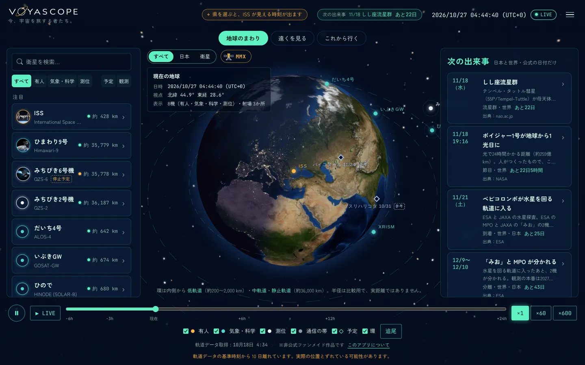
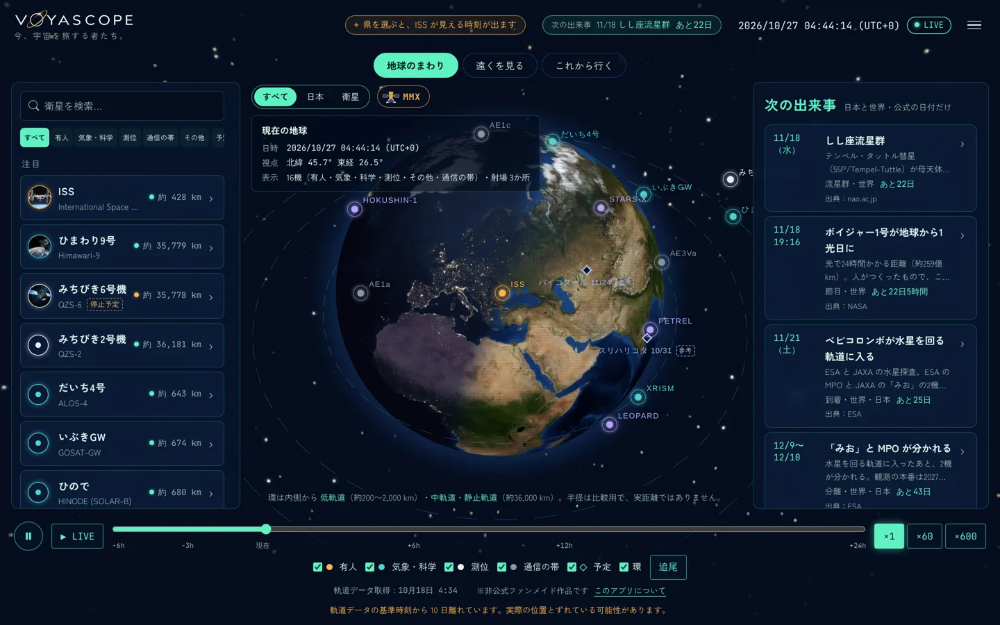
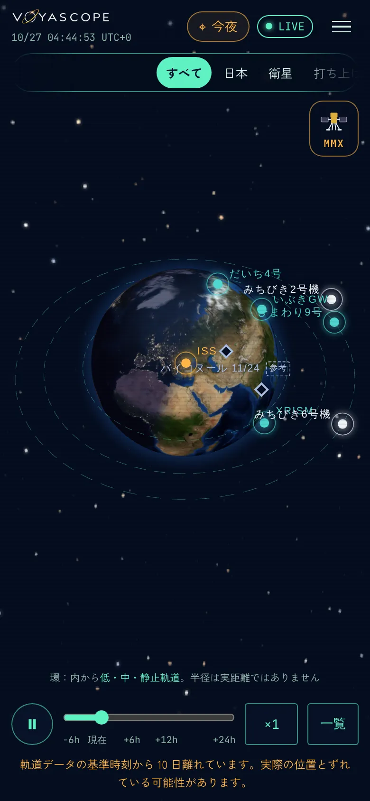
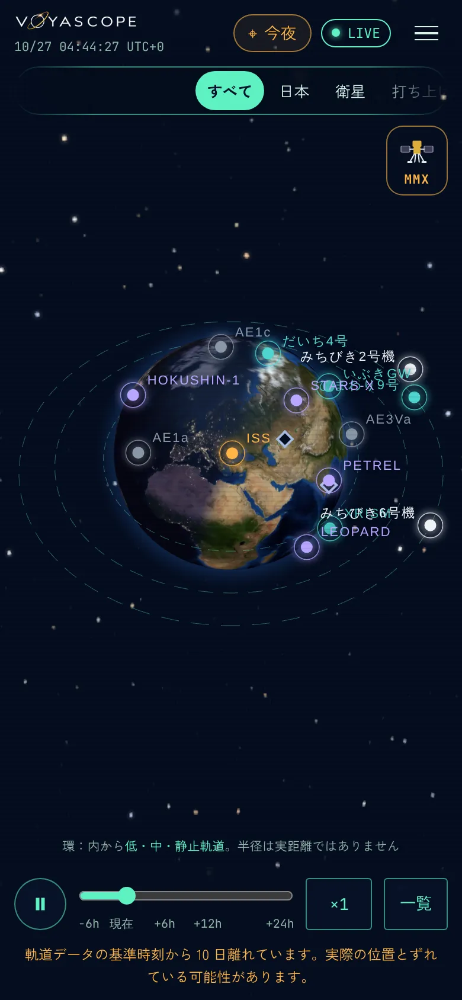
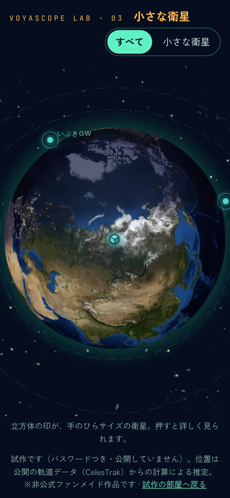
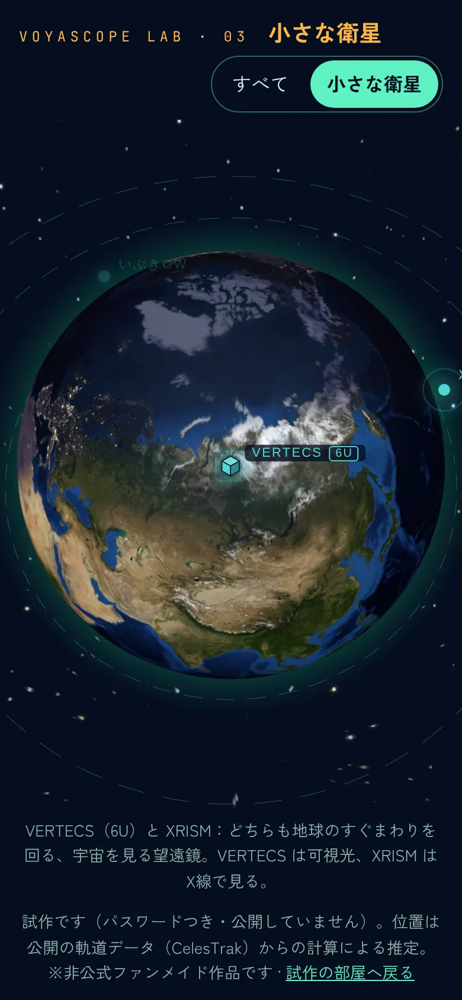
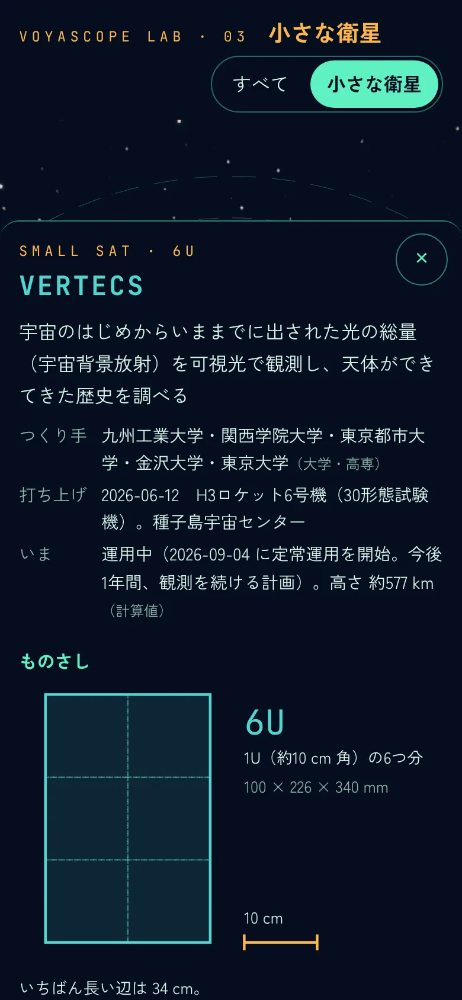
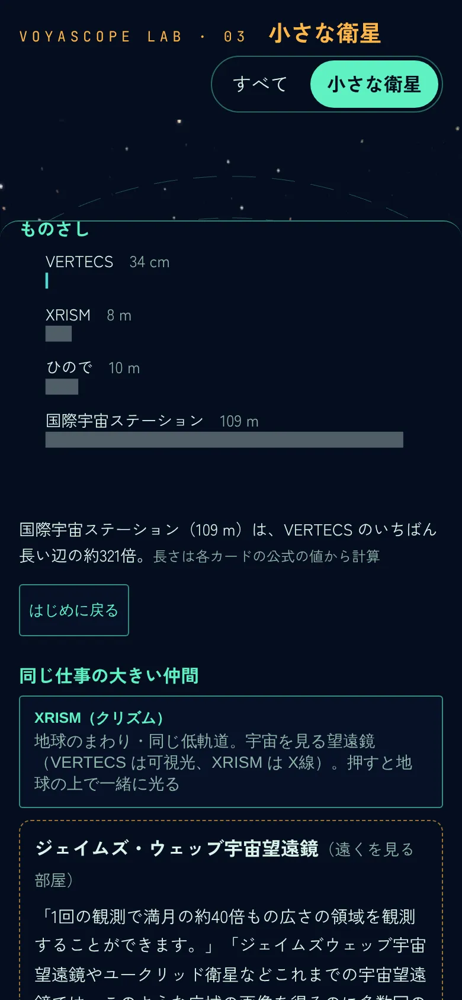

# 日本のキューブサットを地球の上に（検討・案）

> 2026-10-27 Claude Code 案（オーナーの依頼：「日本の関連するキューブサットを載せたい。研究者でない人に、手のひらサイズの衛星が大型のものと同じように役割を果たしていることが見えるように」）。
> **2026-10-27 オーナーの返事**：1. 言い方 OK／2. 下の「どこを回っているか」を踏まえて最初の1機を検討し直す／3. 一旦表示して混み具合を見る／4. 記録（アルテミス含む）を「今風のインタラクティブなメモリ」にするか検討／5. 出自・所属にあたる言葉を（分類は同じ）／6. C38 に掲載の確認要綱を入れる → 下の 8.〜12.
> **状態：方針は OK（2026-10-27）。C38 照合済み → VERTECS のカードを入れた（地球の画面にはまだ出さない）。下の 13.** この文書はカードの出典にならない。下の候補は Claude Code が検索で当たりをつけただけで、**照合していない**（チャッピーへの依頼 C38 → 照合 → `curation/`、の順。RULES.md）。調べた日：2026-10-27。
> 拘束：`RULES.md` ＞ [`sky-families.md`](sky-families.md) ＞ この案。

## 0. 結論（先に）

- **「大型と同じ役割」は、そのまま言うと言いすぎになる。** 一次資料が言っているのは「同じ空で、同じ種類の仕事（宇宙を見る・地球を撮る・電波をやりとりする）をしている。そのうえで得意なことが違う」まで。見せる文も、そこに合わせる（1.）
- **いちばん強い材料は VERTECS**（6U の天文衛星）。研究チームの発表が、自分で JWST・ユークリッドと視野を比べている（「1回で満月の約40倍の広さ。これまでの宇宙望遠鏡は多数回の観測が要る」）。JWST はすでに「遠くを見る部屋」にいるので、**小さい望遠鏡と大きい望遠鏡を VOYASCOPE の中で並べられる**（2.・3.）
- **候補はみな地球のすぐまわり（低軌道、高さ約270〜590 km）を回っている。** JWST（約150万 km 先）のそばではない。JWST と比べるのは「場所」ではなく「仕事」（8.）
- **キューブサットは「行って帰ってくる」ものではない。** 回収はせず、空気の抵抗で少しずつ下がり、最後は大気に入って燃えつきる（ISS から放出されたものは数か月〜1〜2年。例：ONGLAISAT は放出から約3か月）。一度入れたら終わり、ではなく「入れ替わる棚」として作る（3. D・4.）
- **見せ方の軸は3つ**：①地球の上では同じ文法の点に「小さな立方体」の印、②カードに**ものさし**（1U＝10 cm の立方体と、同じ仕事の大型機の全長を同じ縮尺で）、③**同じ仕事の大きい仲間**を1つ指して、両方を光らせる（3.）
- [`sky-families.md`](sky-families.md) §10 の「大学キューブの大多数は置かない」は守る。**公式の説明と運用状況のページがある数機だけ**を標本にする（2.1）

---

## 1. ねらいの言い直し（客観的に）

### 1.1 一次資料が言っていること

| 衛星 | 公式に書かれている「小さいのにできたこと」 | 出典（未照合） |
|---|---|---|
| VERTECS（6U・天文） | 視野は1波長あたり 3度×3度、1回で満月の約40倍の広さ。JWST やユークリッドは同じ広さを撮るのに多数回の観測が要る。地上の望遠鏡で数時間の露光が要る鮮明な画像を1分の露光で | [東大工学系 プレスリリース 2026-09-04（PDF）](https://www.t.u-tokyo.ac.jp/hubfs/press-release/2026/0904/001/text.pdf) |
| ONGLAISAT（6U・地球観測） | 地上の分解能 2.44 m を達成（2025-02 の発表）。2025-03-04 に大気へ再突入 | 報道・データベースで当たりをつけただけ（[Wikipedia](https://en.wikipedia.org/wiki/ONGLAISAT) など）。公式（アークエッジ・東大・TASA）で要確認 |
| AE1a・AE1d・AE3Va（6U・通信） | 3機の星座（コンステレーション）として、船の位置の把握と通信（VDES）を実証。AE1a は衛星からの送信を初めて試す | [アークエッジ・スペース 2026-03-31](https://arkedgespace.com/news/2026-03-31_ae1a) |

### 1.2 そこから言えること・言えないこと

- 言える：**同じ低軌道を回り、同じ種類の仕事をしている**／**得意なことが違う**（VERTECS は「広く一度に」、JWST は「深く細かく」）／**何機かで組んで仕事をする**ものがある（AE の3機）
- 言えない：「大型と同じ性能」「大型の代わりになる」。比べた数値は、公式が自分で比べたものだけ使う（RULES.md ルール3。性能の格付けもしない＝ランク色を使わない方針と同じ）
- 画面の一文（案）：**「手のひらサイズでも、宇宙の仕事をしている。得意なことは、大きな衛星とちがう」**

### 1.3 いまある選択肢（市場）

| 種類 | 例 | キューブサットの見え方 |
|---|---|---|
| 海外の追跡サイト | n2yo、satellitemap.space | 数万の点の1つ。大きさも仕事も見えない |
| 研究者・愛好家向けの一覧 | nanosats.eu、SatNOGS DB | 英語・表。網羅的だが「何がすごいか」は書いていない |
| 公式 | JAXA の J-SSOD（きぼうからの放出）のページ、各大学・企業のプレスリリース | 放出・打ち上げの「その日」だけ。いまどこにいて何をしているかは、ばらばら |

**空いているところ**：日本語で、「いまここを回っている手のひらサイズのこれが、こういう仕事をしていて、大きい衛星と比べるとこう」を1画面で見せるもの。検索数などの数値は取っていない（推測しない）。

中高生にとっての近さ：キューブサットは大学・高専の学生が作って運用している（例：VERTECS は関西学院大学の学生が運用の中心〈[関西学院大学 2026-06-17](https://www.kwansei.ac.jp/assets/20260617_houdou_1400.pdf)、未照合〉）。「数年先の自分が関われるかもしれない衛星」は、ほかの大型機にない切り口。ただし**人物は出さない**（研究室名・大学名まで。RULES.md の人物の細則）。

---

## 2. 候補（**未照合**。C38 で確かめる）

### 2.1 選ぶ基準（案）

1. 運用者（大学・JAXA・企業）の**公式ページに任務と運用状況**がある
2. 打ち上げ・放出の日が公式で分かる
3. NORAD 番号が公式か CelesTrak の SATCAT で分かる
4. 任務が公表されている（`undisclosed` で埋めない。sky-families §10）
5. 運用中（`operating`）のときだけ地球の上に置く。終わったら記録に回す（3. D）

### 2.2 当たりをつけたもの

| 名前 | 大きさ | 仕事 | 打ち上げ・放出 | 状態（当たり） | 同じ仕事の大きい仲間（案） |
|---|---|---|---|---|---|
| **VERTECS**（九工大・関西学院大・東京都市大・金沢大・東大） | 6U | 宇宙の可視光の背景放射を観測する望遠鏡 | 2026-06-12 H3 6号機（種子島） | 2026-09-04 定常運用へ。1年の観測の計画 | JWST（遠くを見る部屋）・XRISM（地球の画面） |
| **AE1a**（アークエッジ・スペース） | 6U | 船の位置と通信（VDES）。AE1d・AE3Va と3機で | 2026-03-30 Falcon 9（Transporter-16） | 初期運用中（3/31 時点）。5/14 アンテナ展開 | ❓（船を見る大型衛星。だいち4号の船舶 AIS など、公式で確かめてから） |
| AE1d（CelesTrak では AE1C）・AE3Va（同上） | 6U？ | 同上 | 2025 | 運用中（3/31 の発表の書き方） | 同上 |
| STARS-X（静岡大） | ❓ | ワイヤーを伸ばして宇宙ごみを捕まえる実験 | 2026-06-12 H3 6号機 | ❓ | ―（大型の仲間がいない＝それ自体が話になる） |
| PETREL（東京科学大） | ❓（キューブでないかも） | ❓ | 2026-06-12 H3 6号機 | ❓ | ❓ |
| LEOPARD（九工大） | ❓ | ❓ | 2026-02-03 きぼうから放出（J-SSOD#35） | ❓ | ❓ |
| HOKUSHIN-1（北大） | 3U？ | ❓ | 2026-06 きぼうから放出（J-SSOD#37）？ | 電波を確かめられていない、という記録あり（非公式） | ❓ |

記録（もう運用していない。「役目を終えた小さな衛星」の棚の候補）：

| 名前 | メモ |
|---|---|
| ONGLAISAT（6U） | 2024-12 きぼうから放出 → 2025-03-04 再突入。台湾の TASA と東大・アークエッジの共同（**国名・地名の書き方はルール5**） |
| EYE（ソニー・STAR SPHERE、6U） | 2023-01 打ち上げ → 2025-02-19 運用終了（[Impress Watch](https://www.watch.impress.co.jp/docs/news/1664027.html) などの報道。公式で要確認） |
| EQUULEUS・OMOTENASHI（JAXA、6U） | アルテミス1号に相乗り（2022）。深宇宙のキューブサット。アルテミス2号のページとつながる |

入れないもの（案）：同じ H3 6号機の BRO-22（フランスの企業、船の電波の監視。日本の衛星ではない）、HORN-L/R（BULL 社。中身を確かめてから判断）。

---

## 3. 見せ方（案）

### A. 地球の上：同じ文法＋「小さな立方体」の印

- 点・ラベル・環は、いまの機体と同じ。色は**仕事の家族の色のまま**（VERTECS は気象・科学のティール、AE は通信）。大きさは家族ではなく「形」なので、色を増やさない（「色は強さではない」）
- 点の横に、小さな立方体の印と「6U」。読み上げは「VERTECS、手のひらサイズの衛星」
- 同時に光る固有名は最大10（sky-families §12）。キューブサットは**ふだんは名前を出さず印だけ**、表示切替の「日本」と、新しく足す「小さな衛星」（案。スワイプの列の「衛星」の次）で名前を出す

### B. カードの「ものさし」（いちばんの見どころ）

- 1U＝10 cm の立方体を、**手のひら（汎用のシルエット。写真は使わない）**と並べる
- その下に、同じ縮尺の線で「同じ仕事の大きい仲間」の全長（`stats.length_m`。公式の値があるものだけ）。例：VERTECS（6U、約 0.1×0.2×0.3 m ※公式の寸法で確かめる）と ひので（10 m）・XRISM
- 「手のひら → 机 → 教室 → バス」のような目盛りは、数値が公式で確かめられたものだけ（バスの長さなど、事実でないたとえは足さない）

### C. 「同じ仕事の大きい仲間」

- カードの下に1行：「同じ仕事の大きい仲間：JWST（遠くを見る部屋）」。押すと地球の上の両方（または部屋の針）が同時に光る
- 比べる文は、公式が自分で比べた文だけ（VERTECS なら 1.1 の「満月の約40倍の広さを1回で」）。比べる文がなければ、仲間の名前だけ出して比べない
- 組み合わせを選ぶのは編集（VOYASCOPE の判断）なので、カードの事実（`source` つき）とは分け、`config/` に置く（案：`config/cubesat-pairs.json`）

### D. 寿命：「入れ替わる棚」

- きぼうから放出されたものは、高度が少しずつ下がって大気に帰る。6時間ごとの軌道データから**「放出から○日・いまの高度」**を出す（計算だけ。将来の落ちる日は予想しない＝推測しない）
- 運用者が終わりを発表したら `status: ended`、地球の上から外して「役目を終えた小さな衛星」の記録へ（ONGLAISAT・EYE など。「帰ってきた」は回収されたように読めるので使わない）。人ではないので `memorial` の扱いではなく、ふつうの記録
- 高度の移り変わりの線（履歴）は、いまの `web/data/orbits/` が上書きなら新しく貯める必要がある → 実装のときに確かめる

### E. つながり（既存の画面と）

- 射場のピン：「種子島から H3 6号機で上がった6機のうちの1つ」（VERTECS）。打ち上げのピンの「上がったあと」の話になる
- ISS：きぼうから放出されたものは「ISS から生まれた」。ISS と同じ環で、少しずつ下へ離れていくのが見える（計算した位置だけ）
- アルテミス2号のページ：EQUULEUS・OMOTENASHI（アルテミス1号の相乗り）を記録として

---

## 4. データと仕組み（案）

| 変更 | 中身 | 注意 |
|---|---|---|
| スキーマ | `spacecraft.schema.json` に `form_factor`（事実。例 `{"value":"6U","source":…}`）と、任意の `size_m`（寸法） | 変えたら `npm run validate`。ブランチと PR |
| カード | `curation/spacecraft/vertecs.json` など | C38 で照合したものだけ |
| 軌道 | `config/orbits.json` に NORAD 番号を足す | CelesTrak の利用方針（C1）で、1件ずつ・6時間ごとのまま。足すのは数機まで。再突入したら GP が取れなくなる → 取得の失敗で CI を落とさない扱いが要る |
| 仲間 | `config/cubesat-pairs.json`（編集の組み合わせ） | 事実の出典とは分ける |
| 画面 | 立方体の印・ものさし・仲間の行・「小さな衛星」の表示切替 | まず試作の部屋（`/lab/`）で |
| 重さ | 立方体の印と手のひらは SVG 数 KB | `config/size-budget.json` の範囲で |

---

## 5. ルールとの関係

- ルール3：運用状況は運用者のページで確かめたときだけ書く。キューブサットは公式の更新が止まりがち → 状態が確かめられないものは**置かない**（「たぶん動いている」で点を置かない）
- 人物：大学・研究室・企業の名前まで。学生・先生の名前とコメントは載せない（プレスリリースにあっても）
- **ルール5（法律が絡みそう。オーナーに判断してもらう）**
  1. 衛星の画像・動画（大学・企業の写真。VERTECS の撮った天体の画像を載せるか、リンクだけか）の利用条件
  2. 企業名・サービス名（STAR SPHERE、EYE など）の書き方（商標）
  3. 海外と共同の衛星（ONGLAISAT の TASA）の国名・地名の書き方
  4. AE1a は経済安全保障の制度の資金で作られている（発表に書いてある）。運用主体は事実として書く（ルール4）。書き方の確認

---

## 6. 段取り（案）

1. **オーナーの OK**（この案。下の 7.）
2. **チャッピーに C38 を依頼**（下の依頼文の案）
3. 報告を `voyascope-research` の `research/chappy/` に保存 → 公式ページで照合 → `research/verification/`
4. スキーマとカード（PR。VERTECS 1機から）
5. 見せ方の試作（`/lab/`）：ものさし → 仲間の行 → 立方体の印 → 表示切替
6. 地球の画面へ。roadmap に M10（案）として載せる

### C38 の依頼文と掲載の確認要綱（2026-10-27 オーナー：確認要綱を入れる）

依頼文（案。`prompts/chappy-research.md` の形に合わせて渡す）：

> 日本の機関（大学・高専・JAXA・企業）が作った、または運用している CubeSat（1U〜12U）について、下の「掲載の確認要綱」の項目を1機ずつ、公式の出典 URL つきで調べてください。対象は2つ：(1) 2026-10 時点で軌道上にあり、運用者の公式ページで「運用中」と確かめられるもの（候補：VERTECS、AE1a・AE1c〈AE1d と同じか〉・AE3Va、STARS-X、PETREL、LEOPARD、HOKUSHIN-1）、(2) 2022年以降に運用を終えた・大気に入ったもの（候補：EQUULEUS、OMOTENASHI、ONGLAISAT、EYE）。確かめられない項目は「確認できず」と書き、推測で埋めないでください。

**掲載の確認要綱**（全部が ✅ になったものだけ `curation/` に入れる。照合は Claude Code が公式ページを開いて行い、`research/verification/` に記録）

| # | 項目 | 必須 | 確かめる先 | 満たさないとき |
|---|---|---|---|---|
| 1 | 名前（日・英）と、公式の愛称 | ✅ | 運用者・開発者の公式ページ | 載せない |
| 2 | つくり手（開発）と運用者、その種類（大学・高専／企業／JAXA・研究機関） | ✅ | 同上 | 載せない |
| 3 | 大きさ（U）・寸法・質量 | ✅（U は必須。寸法・質量は任意） | 同上 | U がなければ載せない。寸法がなければものさしは U だけで描く |
| 4 | 任務（公表されている仕事） | ✅ | 同上 | 載せない（`undisclosed` で埋めない） |
| 5 | 打ち上げ・放出の日と手段（ロケット・きぼう） | ✅ | 運用者、JAXA、打ち上げ事業者 | 載せない |
| 6 | NORAD 番号 | ✅ | 運用者の発表、なければ CelesTrak SATCAT（国際標識で突き合わせ） | 地球の上に置かない（記録だけ） |
| 7 | 運用状況とその日付 | ✅（運用中の棚） | 運用者の公式ページ・発表（最新のもの） | 地球の上に置かない。6か月以上公式の更新がなければ C38 の報告で知らせてもらう |
| 8 | 終わった日と終わり方（運用終了・大気に入った・通信途絶） | ✅（記録の棚） | 運用者の発表。大気に入った日は公的データ（CelesTrak SATCAT の DECAY）も | 「終わった日は確認できず」と書いて載せるかはオーナー |
| 9 | 公式に書かれた大型機との比較（原文） | 任意 | 運用者の発表 | 「同じ仕事の大きい仲間」は名前だけ。比べる文は出さない |
| 10 | 画像・動画の利用条件のページ | 任意 | 運用者の公式ページ | 画像は載せず、公式ページへのリンクだけ（ルール5） |
| 11 | 軍・安全保障に関わる資金や任務の有無 | ✅（あれば書く） | 運用者の発表 | ルール4（事実として書く）。書き方はオーナー |
| 12 | 海外との共同（国・機関名の公式の書き方） | ✅（あれば） | 運用者・相手の機関の公式ページ | ルール5（オーナーに確認） |
| 13 | 人物の名前 | ― | ― | **集めない・載せない**（発表に名前やコメントがあっても） |

## 7. オーナーに判断してほしいこと

決まったこと（2026-10-27 オーナー）：

- 言い方は「同じ種類の仕事をしている。得意なことが違う」
- 最初は VERTECS（地球の上では XRISM と組む）、2段目にアークエッジの3機（9.）
- 地球の上は、ふだんは名前なしの立方体の印だけ・置くのは2〜4機。表示切替に「小さな衛星」を足す（10.）
- 記録（メモリ）を試作の部屋で作る（11.）
- 言葉は「つくり手」（大学・高専／企業／JAXA・研究機関）（12.）
- 企業の衛星も大学のものと同じ扱い
- C38 に掲載の確認要綱を入れて依頼する → 依頼文は `prompts/chappy-research.md` の C38

残り：

1. 5. のルール5の4項目（画像の利用条件・商標・海外との共同の書き方・安全保障の資金の書き方）。C38 の報告（要綱の10〜12）を材料にして判断してもらう

---

## 8. どこを回っているか（2026-10-27 オーナーの問いへ）

| 名前 | 高さ（約） | 傾き | メモ |
|---|---|---|---|
| VERTECS | 563 km | 97.7° | 太陽同期に近い軌道。H3 6号機の同乗の STARS-X（569 km）・PETREL（569 km）も同じ面 |
| AE1a・AE1c・AE3Va | 587・405・572 km | 97.4〜97.8° | アークエッジの「AE1d」は CelesTrak では見つからず、「AE1C」がある → C38 で名前を確かめる |
| HOKUSHIN-1 | 399 km | 51.6° | きぼうから放出（ISS と同じ傾き） |
| LEOPARD | **271 km** | 51.6° | きぼうから放出。ISS（約420 km）よりかなり下がっている＝**大気に入る日が近い** |

高さは CelesTrak の GP データ（エポック 2026-10-26）の平均運動から計算した概算（公的データ。カードに入れるときは運用者の値を優先）。

- **みな地球のすぐまわり（低軌道）。** ISS・ひので・XRISM・だいち4号と同じ環にいる。JWST は太陽と地球の L2（約150万 km）で、地球の画面ではなく「遠くを見る部屋」にいる。VERTECS と JWST を並べたのは、**同じ「宇宙を見る望遠鏡」という仕事**だから（場所ではない）
- **「行って帰ってくる」ものではない。** 回収しない。空気の抵抗で少しずつ下がり、最後は大気に入って燃えつきる。下がる速さは高さで大きく変わる（ISS から放出されたものは数か月〜1〜2年。500 km 台は年単位）。いつ落ちるかの予想は書かない（推測しない）。画面で見せられるのは「いまの高さ」と、その移り変わりだけ
- 深宇宙のキューブサット（アルテミス1号の EQUULEUS・OMOTENASHI）も、帰ってきていない（運用を終えた。記録の側。11.）

## 9. 最初の1機（8. を踏まえて検討し直し）

| 案 | 地球の画面での組み合わせ | よいところ | 弱いところ |
|---|---|---|---|
| **A. VERTECS**（おすすめ） | **XRISM**（同じ環・同じ「宇宙を見る望遠鏡」）。JWST は「遠くを見る部屋へ」のリンクで、公式の比べた文（視野が満月の約40倍）といっしょに | 大学の天文衛星。公式の比べる文がある。種子島から上がった。1年の観測の計画で、しばらく置ける | 比べる相手の JWST が別の部屋。XRISM とは仕事（X線と可視光）が違う、と添える必要 |
| B. アークエッジの3機（AE1a・AE1c・AE3Va） | 3機がいっしょに光る | 「小さいものは何機かで組んで仕事をする」が地球の上で見える（大型にない見せ方） | 企業の衛星（5.）。船の通信（VDES）は中高生にとって遠い。名前で区別しにくい |
| C. LEOPARD | ISS（同じ傾き。下にずれていく） | 「下がって燃えつきる」が、いまの高さで見える | もうすぐ運用が終わる。置いてすぐ外すことになる |

**おすすめ：A で始め、B を2段目に**（「1機で広く見る」→「何機かで組む」）。C は記録の側（11.）で「最後の高さ」として見せる。

## 10. 混み具合（一旦表示してみた）

候補8機（VERTECS・STARS-X・PETREL・AE1a・AE1c・AE3Va・LEOPARD・HOKUSHIN-1）を、**手元の複製のアプリだけ**に仮のカードで入れて、いまの画面と並べた（公開していない。`curation/` も変えていない）。

| | いま | 8機を足す |
|---|---|---|
| 機体 | 8 | 16（同時に光る固有名の上限 10 をこえる） |
| PC |  |  |
| スマホ |  |  |

（手元のデータが古く、既存の機体の位置は 10/18 の軌道データのもの。混み具合を見るのには足りる）

分かったこと：

- **PC はまだ読める。** 名前が地球のまわりに散る。ただ「その他」の紫が一番多い色になり、画面の色の釣り合いが変わる（キューブサットの多くは「技術の実証」で `technology`＝その他）
- **スマホは名前が重なる。** STARS-X とひまわり9号、みちびき6号機と XRISM と LEOPARD。いまの8機でも重なりかけているところに足すので、名前を全部出す形は無理
- 同じ打ち上げの VERTECS・STARS-X・PETREL は、いま互いに約4,500〜13,800 km 離れている（計算）。**同じロケットで上がっても、地球の上で固まって見えるわけではない** → 「同じ打ち上げの仲間」は位置ではなく、カードや記録で見せる
- 結論（案）：**ふだんは名前を出さず、小さな立方体の印だけ**（3. A のとおり）。名前は、押したとき・「小さな衛星」の表示のときだけ。地球の画面に置くのは 2〜4機まで（9. の A＋B）。それ以外は記録の側へ

## 11. 記録を「インタラクティブなメモリ」にするか

**おすすめ：作る。ただし地球の画面とは分けて、小さく始める。**

- 理由：運用中のキューブサットは少なく入れ替わりが速い。一方、終わったもの（記録）は増えていく。地球の上に置くと混む（10.）が、記録は混まない。**地球＝いま、記録＝これまで**、と分けると両方が生きる
- 形（案）：年ごとに横に流れる棚。1つずつ**同じ縮尺の立方体のシルエット**で並び（1U・3U・6U の違いが一目で）、選ぶとカード（大きさ・つくり手・期間・やったこと・終わり方〈燃えつきた・運用終了・通信が途絶えた〉）。しぼり込みは「地球のまわり／月・深宇宙」と「つくり手」（12.）
- 入るもの（候補・未照合）：EQUULEUS・OMOTENASHI（アルテミス1号）、ONGLAISAT、EYE、これから終わる LEOPARD など。**アルテミス1号の相乗りは10機だが、日本のものは2機**（ほかは米・伊などの機体なので、日本の関連として載せるのはこの2機）
- 将来：キューブサット以外（運用を終えた大型機・MMX の ARCHIVE）も同じ棚に入れられる。最初はキューブサットだけ
- 費用：記録1件ごとに出典が要る（C38 で一緒に頼む）。1件ずつ足せる形にして、最初は5〜6件
- 置き場所：試作の部屋（`/lab/`）で作って、よければ地球の画面の「小さな衛星」から入る

## 12. 「つくり手」という言葉（出自・所属の言い方）

- **おすすめ：「つくり手」**（だれが作ったか）。いまのカードの「運用」（だれが動かしているか）とは分ける。キューブサットは、作ったところと動かしているところが違うことがある（大学が作って企業の地上局で運用、など）
- 分類（つくり手の種類）：**大学・高専／企業／JAXA・研究機関**。カテゴリは「小さな衛星」1つのまま、つくり手は印としぼり込みに使う
- 表示（例）：「つくり手：大学（九州工業大学 ほか4校）」「運用：九州工業大学・関西学院大学 ほか」
- ほかの候補：「開発」（正確だが硬い）、「出身」（人に使う言葉で、人物の扱いと混ざる）、「生まれ」（印象はよいが、事実の項目名には向かない）
- スキーマ（案）：`builder`（事実。`value` に機関名、`type` に university / company / agency）。変えるのはオーナーの OK のあと

## 13. C38 の結果（2026-10-27 照合）

照合の記録：voyascope-research の `research/verification/2026-10-27-c38.md`

| 機体 | 結果 | 次 |
|---|---|---|
| **VERTECS** | 必須の項目がそろった（NORAD 69506 は CelesTrak SATCAT で名前・日付・射場を突き合わせた）。JWST・ユークリッドとの比べの原文も Claude Code が確認 | **カードを入れた**（`curation/spacecraft/vertecs.json`）。`config/orbits.json` にはまだ足さない＝地球の画面・「一言でわかる」には出ない。立方体の印・ものさし・XRISM との組を試作の部屋で作ってから足す |
| AE1a・AE1d・AE3Va | 報告の引用は原文どおり。ただし運用状況が 2026-03-31 の発表のまま（7か月前）。AE1d と CelesTrak の AE1C が同じかは未確認 | 保留（オーナーに判断を聞く） |
| STARS-X・PETREL・LEOPARD・HOKUSHIN-1 | 報告でも①〜⑫が未確認 | 入れない。必要ならもう一度頼む |
| OMOTENASHI | 打ち上げ・運用終了（2023-11-02 発表、通信可能な限界距離で終了・月面着陸の試験はできず）を確認 | 記録の棚の候補（U は未確認） |
| EQUULEUS | 打ち上げ・分離後の正常動作は確認。終わりは未確認 | 記録の棚には終わりを確かめてから |
| EYE | オーナーが貼った STAR SPHERE のページの原文で確認（2026-10-27）：ソニーが事業主体・東京大学と開発・JAXA はアドバイザー、2023年1月打ち上げ、2025年2月末の大気圏再突入まで運用、約500名に撮影体験を提供 | 記録の棚の候補（U・NORAD・再突入の日は未確認。サービス名の扱いはルール5） |
| ONGLAISAT | 報告でも未確認 | 入れない |

カードの形（スキーマ）に足したもの：`builder`（つくり手）・`builder_type`（university / company / agency）・`form_factor`（例 "6U"）。カードの詳細に「つくり手」の行と「大きさ 6U」が出る（書いた機体だけ）。「一言でわかる」は地球の画面に出している機体だけ作るようにした（VERTECS のページが「地球のまわりで見る」とリンクしてしまうため）

## 14. 試作の部屋 03「小さな衛星」と掲載のお願い（2026-10-27）

- **オーナー**：アークエッジと VERTECS には「ここに映してもいい？引用と、必要に応じて指示いただいた文言つきで」とメールで確かめてから出す。下書きは voyascope-research の `research/outreach/2026-10-27-cubesat-permission.md`（VERTECS はプロジェクトのメール、アークエッジは問い合わせフォーム）
- **試作**：`web/lab/cubesat/`（パスワードつきの /lab/cubesat/）
  - 「すべて」：VERTECS は名前なしの立方体の印だけ（家族の色＝気象・科学のティール。紺のふちどり）
  - 「小さな衛星」：VERTECS の名前と「6U」が出て、XRISM が光り、ほかの機体は薄くなる。下に「どちらも地球のすぐまわりを回る、宇宙を見る望遠鏡。VERTECS は可視光、XRISM は X線で見る」
  - 印を押すと詳細：任務・つくり手・打ち上げ・いま（運用中・計算した高さ）→ **ものさし**（6U の面を 1U ずつ区切って 10 cm の目盛りと → 押すたびに XRISM 8 m・ひので 10 m・ISS 109 m を同じ縮尺の棒で足す。倍率はカードの公式の値から計算）→ **同じ仕事の大きい仲間**（XRISM を押すと地球の上で一緒に光る／JWST は九州工業大学の発表の原文をそのまま引用）
  - 手のひらの絵は描いていない（大きさの数字に出典がないため。「10 cm」の目盛りで代える）
- **データ**：`config/orbits.json` に `{ "id": "vertecs", "lab": true }`。軌道は6時間ごとに取るが、アプリの一覧（craft-index）・「一言でわかる」には入れない。ただし `data/cards/vertecs.json`・`data/orbits/vertecs.json` は voyascope.org の URL で読める（どこからもリンクしない。中身は公開のリポジトリにある事実と同じ）
- 画像：`docs/screenshots/cubesat-lab/`

| すべて | 小さな衛星 | ものさし（6U） | ものさし（ISS まで） |
|---|---|---|---|
|  |  |  |  |

気づいたこと：スマホでは XRISM が画面の端にかかることがある（いまは VERTECS を真ん中にしているだけ）。返事が来て本番へ入れるときは、2機が両方入る向きにカメラを合わせる
